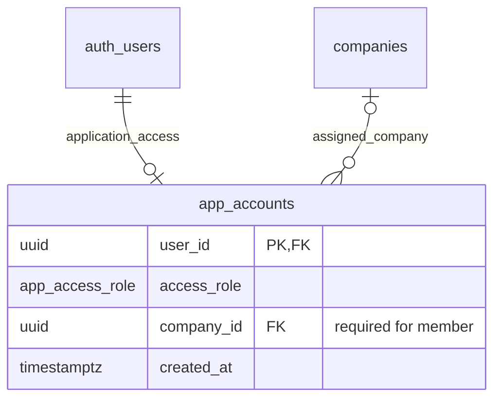

# Application access

The application distinguishes **Administrator** (`administrator`), **Member**
(`member`), and **Unassigned** (`unassigned`). The frontend, API, database, and Python
use these same lowercase role values; user-facing labels capitalize them. Everyone signs up
or signs in with email and password through Supabase Auth and uses their own access
token. A **DB manager** connects directly to PostgreSQL with trusted DB credentials
and is not represented by an application role or Auth account.

## Account model



`public.app_accounts.user_id` references `auth.users.id`. There is at most one
application account per Auth user. Administrators and Unassigned users have no
company; members must have exactly one existing company.

An Auth signup trigger inserts an **Unassigned** account. Its role is never copied
from user-editable metadata. New users can sign in and wait for assignment, but
cannot read company data. Email confirmation follows the Supabase project's Auth
configuration: with confirmation enabled the user confirms the email before
signing in; with confirmation disabled signup can immediately establish a session.
Use configured SMTP delivery and approved redirect URLs when enabling confirmation.

Administrators assign a company, transfer membership to another company, or revoke
membership back to Unassigned. Revocation retains the Auth identity and app account.
Deleting the Auth identity cascades to its app account. The database's current
role and company govern each request, including already-issued access tokens.
Unassigned users can read only their own account and zero-valued workspace tokens;
they receive no company, financial, inventory, or source-reference rows.

Only the DB manager can grant or revoke Administrator access. Use the trusted
Python repository with a `DatabaseConnection` backed by the PostgreSQL login:

```python
from services.sync.src.database.account_access import set_administrator_access
from services.sync.src.database.connection import PostgresDatabaseConnection
import os

with PostgresDatabaseConnection(os.environ["DATABASE_URL"]) as database:
    set_administrator_access(database, user_id="EXISTING_AUTH_USER_UUID", enabled=True)
```

The equivalent command keeps credentials out of command-line arguments:

```sh
conda run --no-capture-output -n A-SelBox python -m services.sync.src.cli.administrator_access grant EXISTING_AUTH_USER_UUID --database-url-env DATABASE_URL
conda run --no-capture-output -n A-SelBox python -m services.sync.src.cli.administrator_access revoke EXISTING_AUTH_USER_UUID --database-url-env DATABASE_URL
```

Configure `DATABASE_URL` privately before running these commands. The CLI loads
`services/sync/.env` through the existing application loader unless
`--no-load-dotenv` is supplied. It never defaults to a different database.
Granting clears company membership; revoking an Administrator makes them Unassigned.
Revoking a non-Administrator preserves their existing membership. Unknown user IDs
fail without creating users. The function is private and has no execution grant
for `anon`, `authenticated`, or `service_role`. A Supabase Storage/service-role API
key is not a PostgreSQL login and cannot perform this administration.

## Permissions

| Data or operation | Administrator | Member | Unassigned |
| --- | --- | --- | --- |
| Company and account directory | All companies and accounts | Own company and account | Own account |
| Create companies, change membership and publish assignments | Yes | No | No |
| SKU ownership and fee periods | Current and historical versions | Current versions of own SKUs | No |
| Financial review, reference information and assignment hints | All | No | No |
| Company transactions and monthly payout reports | All companies | Own company | No |
| Current daily inventory | All SKUs | Own SKUs | No |
| Download archives, preprocess sources or run the payout worker | Trusted database and sync process only | No | No |

An administrator uses the Assignments screen for campaigns, promotions and inbound shipments. Each change records its author, reason and version. The SKU editor publishes fee periods with the assignment. A stale version rejects the write. Clearing an assignment removes ownership across all dates and preserves its history.

The member’s access to a live transaction follows the company calculated from current assignments. A transfer changes access on the next request, including requests made with an existing session. A saved report belongs to the company on its header. Members can read that company’s saved records after an assignment changes.

The database grants application roles read access through row-level policies and guarded RPCs. The role and company come from the account for `auth.uid()`. Browsers sign in with the public publishable key. Source acquisition manifests, invoice details, preprocessing jobs and publication privileges belong to trusted server-side processes.

See [source allocation](source_allocation.md) and [payout reports](company_payout_reports.md).
