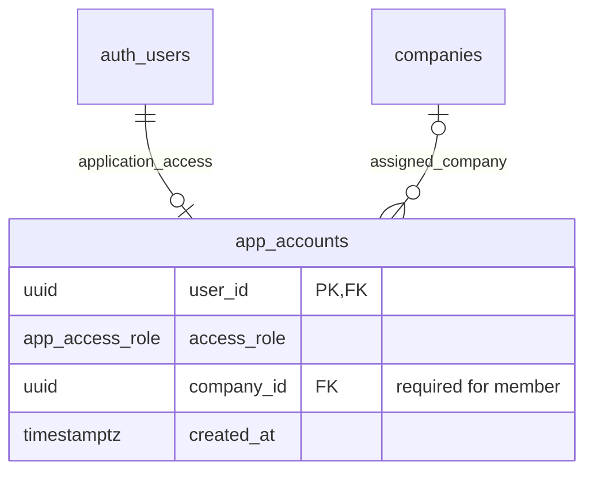

# Application access

The application distinguishes **Administrator** (`administrator`), **Member**
(`member`), and **Unassigned** (`unassigned`). The frontend, API, database, and Python
use these same lowercase role values; user-facing labels capitalize them. Everyone signs up
or signs in with email and password through Supabase Auth and uses their own access
token. A **DB manager** connects directly to PostgreSQL with trusted DB credentials
and is not represented by an application role or Auth account.

## Account model



`public.app_accounts.user_id` references `auth.users.id`. There is at most one
application account per Auth user. Administrators and Unassigned users have no
company; members must have exactly one existing company.

An Auth signup trigger inserts an **Unassigned** account. Its role is never copied
from user-editable metadata. New users can sign in and wait for assignment, but
cannot read company data. Email confirmation follows the Supabase project's Auth
configuration: with confirmation enabled the user confirms the email before
signing in; with confirmation disabled signup can immediately establish a session.
Use configured SMTP delivery and approved redirect URLs when enabling confirmation.

Administrators assign a company, transfer membership to another company, or revoke
membership back to Unassigned. Revocation retains the Auth identity and app account.
Deleting the Auth identity cascades to its app account. The database's current
role and company govern each request, including already-issued access tokens.
Unassigned users can read only their own account and zero-valued workspace tokens;
they receive no company, financial, inventory, or source-reference rows.

Only the DB manager can grant or revoke Administrator access. Use the trusted
Python repository with a `DatabaseConnection` backed by the PostgreSQL login:

```python
from services.sync.src.database.account_access import set_administrator_access
from services.sync.src.database.connection import PostgresDatabaseConnection
import os

with PostgresDatabaseConnection(os.environ["DATABASE_URL"]) as database:
    set_administrator_access(database, user_id="EXISTING_AUTH_USER_UUID", enabled=True)
```

The equivalent command keeps credentials out of command-line arguments:

```sh
conda run --no-capture-output -n A-SelBox python -m services.sync.src.cli.administrator_access grant EXISTING_AUTH_USER_UUID --database-url-env DATABASE_URL
conda run --no-capture-output -n A-SelBox python -m services.sync.src.cli.administrator_access revoke EXISTING_AUTH_USER_UUID --database-url-env DATABASE_URL
```

Configure `DATABASE_URL` privately before running these commands. The CLI loads
`services/sync/.env` through the existing application loader unless
`--no-load-dotenv` is supplied. It never defaults to a different database.
Granting clears company membership; revoking an Administrator makes them Unassigned.
Revoking a non-Administrator preserves their existing membership. Unknown user IDs
fail without creating users. The function is private and has no execution grant
for `anon`, `authenticated`, or `service_role`. A Supabase Storage/service-role API
key is not a PostgreSQL login and cannot perform this administration.

## Permission matrix

| Capability                                              | DB manager              | Administrator                             | Member                                  | Unassigned |
| ------------------------------------------------------- | ----------------------- | ------------------------------------ | ----------------------------------------------- | --- |
| Read application accounts                               | All                     | All accounts            | Own account only                                | Own account only |
| Read companies                                          | All                     | All                                  | Own assigned company                            | No |
| Create companies | Python/SQL | Guarded REST RPC | No | No |
| Assign/revoke company membership or change company  | Yes                     | Yes                                  | No                                              | No |
| Manage Administrator access                                | Yes                     | No                                   | No                                              | No |
| Read company assignments and fee periods                | All versions            | All versions                         | Current terms for own company's SKUs            | No |
| Publish a complete SKU terms version             | Python/SQL              | REST RPC                             | No                                              | No |
| Read source preprocessing facts                         | All retained versions   | All retained versions and categories | Current versions of permitted own-company facts | No |
| Read narrow report/day/version references               | All                     | All, including historical versions   | All current references across companies         | No |
| Read full preprocessing headers and diagnostics         | Yes                     | Yes                                  | No                                              | No |
| Read payout reports, latest reports, authoritative components, and totals | All | All | Own saved company only | No |
| Read current Financial review and frozen payout comparisons/reconciliation | All | All, in Financial review | No | No |
| Read payout input references | All | All | No | No |
| Read current inventory and filter catalogs | All | All current items, including unassigned SKUs | Current items for owned SKUs only | No |
| Publish acquisitions and source results | Python/SQL | No | No | No |
| Inspect payout refresh state and scheduler | SQL | No | No | No |
| Run Data Kiosk pruning                                  | Python/SQL              | No                                   | No                                              | No |
| Read raw document archives                              | Trusted archive service | No                                   | No                                              | No |

Monthly payout reports are generated by the private scheduled worker. Application
roles have no generation RPC or execution grant on the worker or internal publisher.

[Financial review](financial_review.md) is an administrator-only workspace. Its three category summaries group current mature
source facts across all namespaces and marketplaces by month and currency. Bounded invoker RPCs
aggregate the administrator-gated `financial_review_records` view; member roles cannot read either source
fragments or aggregate amounts through these interfaces. Opening a month shows source/type totals
and optional exact source rows. Saved report snapshots remain available inside the month and retain
their original company/report scope. Member reads of payout components
require `authoritative = true` as well as access to the saved company report.
Hiding the review tab is supplemental to these database restrictions.

Members see Settlement `SETTLEMENT` facts and owned Data Kiosk facts
except `SELBOX`. Category rules keep account/control amounts
outside company access. Both the source version and SKU assignment must be
current. Historical activity dates inside a current result remain visible;
"current" refers to the selected version, not the recent date range.

Current report/day/version references are shared with all registered members, including
members whose company has no SKUs. Those references expose only the granted IDs, parent links and
preprocessing labels. Their visibility does not grant access to transactions or full report metadata.

Administrators can read every retained historical result. A pruned Data Kiosk version
keeps its header and pruning marker, but its removed component payload is
unavailable. Payout report references protect required versions, including empty
days, from pruning.

## REST interfaces

The examples below show request paths and JSON bodies. Authenticate with the
caller's normal Supabase access token; never give an administrator a service-role key.

`GET /rest/v1/app_accounts?select=*` lists all accounts for an Administrator and
only the caller's row for other signed-in users. Members can also read their own
company from `/rest/v1/companies`.

### Company creation

Administrators create companies in the **Companies** tab. The [frontend guide](../services/frontend/user-webpage/README.md#workspace)
describes its navigation, draft persistence, and return to the originating editor.

The frontend calls:

```text
POST /rest/v1/rpc/create_company
{"company_name":"Example Company"}
```

The response is a one-row array containing `id`, `name`, and `created`. Outer
whitespace is trimmed; a blank name, NULL, or a name longer than 200 characters
returns HTTP 400 (`22023`). Matching ignores letter case and outer whitespace,
but preserves internal spaces. Repeated or concurrent equivalent requests return
the same company with `created: false` and its existing display spelling. If trusted
imports already created equivalent names, the oldest company is selected by
creation time and then ID. This deduplication applies to the application RPC;
the trusted Python `create_company` function retains its existing explicit-create
semantics. No new global uniqueness constraint changes imported company identities.

The private helper checks the caller's stored Administrator role before validating
the name and serializes equivalent requests with a transaction-level advisory lock.
The company table remains read-only through REST. Creating a company does not
assign users or SKUs, or publish fee changes. A new company updates the existing
fee/catalog revision at commit so automatic workspace refreshes discover it;
reusing an existing company makes no write and does not change that revision.

### Company deletion

Administrators can delete an unused company from its details in **Companies**:

```text
POST /rest/v1/rpc/delete_company
{"target_company_id":"COMPANY_UUID"}
```

The response is a one-row array containing `id` and `deleted`. An already removed
company returns `deleted: false`, making retries safe. A NULL ID returns HTTP 400
(`22023`). Only the caller's stored Administrator role authorizes the request;
authorization happens before looking up the company. Direct company deletes
through REST remain denied, including for administrators.

The server locks the company and rejects deletion with HTTP 409 (`PT409`) if it has
any members, currently assigned SKUs, ownership/fee versions, payout reports, or
payout refresh records. Every historical ownership/fee version counts, including
versions with no fee periods and versions whose SKU has since moved elsewhere.
The error message is `Company cannot be deleted while it has linked records`;
`details` contains a JSON array of positive `{code, count}` entries using `members`,
`assigned_skus`, `terms_versions`, `payout_reports`, and `payout_refreshes`. The UI
displays these reasons instead of silently deleting, reassigning, or cascading
linked records. `other_records` is the safe fallback for an additional restrictive
foreign key. The company lock serializes concurrent assignments/deletions; a
successful deletion updates the existing fee/catalog revision at commit.

### Company membership

The Administrator-only roster includes the current Auth email without exposing
`auth.users`. It is a stable table-valued RPC, so normal PostgREST filters, ordering,
pagination, selected columns, and `Prefer: count=exact` apply to GET and HEAD:

```text
GET /rest/v1/rpc/account_directory?order=email.asc&limit=25
```

Each row has `user_id`, nullable `email`, `access_role`, nullable `company_id`,
`created_at`, and `email_confirmed`. Other roles receive an authorization error.
Email changes are read directly from Auth rather than copied into a stale profile.

Assign or transfer company membership using the account state displayed while editing:

```text
POST /rest/v1/rpc/set_company_membership
{"target_user_id":"AUTH_USER_UUID","target_company_id":"COMPANY_UUID","expected_access_role":"unassigned","expected_company_id":null}
```

Revoke a member back to Unassigned:

```text
POST /rest/v1/rpc/set_company_membership
{"target_user_id":"AUTH_USER_UUID","target_company_id":null,"expected_access_role":"member","expected_company_id":"COMPANY_UUID"}
```

The response is an array containing the updated `app_accounts` row. The server
locks the target before validating its role and expected state. A stale edit returns
HTTP 409 (`PT409`); the UI must reload the account instead of overwriting another
Administrator's change. Administrator targets always fail with `42501`, including
when a DB manager promoted the target while an edit waited for its lock. Invalid
company IDs fail their foreign key check. Direct INSERT, UPDATE, and DELETE on
`app_accounts` are denied to all browser users. No request parameter can grant an
Administrator role, change an Auth identity, or remove an Administrator.

### SKU configuration

Administrators stage assignment and fee changes in **Current fees**, then publish them together
through `POST /rest/v1/rpc/publish_sku_configuration`:

```json
{
  "p_change_reason": "Initial complete terms",
  "p_changes": [
    {
      "sku": "SKU-001",
      "company_id": "COMPANY_UUID",
      "expected_current_version_id": null,
      "periods": [
        {
          "marketplace_name": "Amazon.com",
          "valid_from": "2026-01-01",
          "valid_to": null,
          "fee_rate_percent": "5"
        }
      ]
    }
  ]
}
```

The changes array must be nonempty and the reason must be nonblank. Use each SKU's selected
terms UUID instead of NULL for a replacement. Each changed SKU submits its complete fee
inventory. Rates are decimal strings; a period's end is exclusive and may be null for an
open-ended period. The server locks changed SKUs in a common order, checks expected
versions, and validates the resulting configuration for **every currently known SKU**, including
unchanged entries. Missing ownership or required fee coverage rejects the whole batch. A stale
edit returns HTTP 409. A successful response contains `published`, an array of
`{sku, terms_version_id}` entries, and `changed_count`.

| Publication result | SQLSTATE | Response |
| --- | --- | --- |
| Caller is not an administrator | `42501` | Access denied before validating the submitted configuration. |
| Stale selected terms | `PT409` | `SKU configuration changed while editing`; no changes published. |
| Missing owner or applicable fee | `23514` | `SKU configuration is incomplete`; `DETAIL` contains JSON `{issues: [...]}`. |
| Malformed or invalid configuration | `23514` | `Invalid SKU configuration`; no changes published. |

Each completeness issue has `sku`, `kind` (`missing_company` or `missing_fee`),
`marketplace_name`, `valid_from`, and `valid_to`. Missing-company issues use null marketplace
and dates. Missing-fee issues describe a consecutive uncovered `[valid_from, valid_to)` range.

Known SKUs include registered identities and all retained imported SKU names. Fees must cover
commission-capable dates in the selected versions of both sources, including zero bases. A SKU
with only noncommission activity needs ownership but no invented rate. Existing incomplete
configuration remains readable; imports committed after validation may introduce new gaps.
Members can read their own configuration and cannot publish changes.

`POST /rest/v1/rpc/sku_configuration` takes no arguments and returns `{items: [...]}`.
Each item contains `sku`, nullable `sku_id`, `company_id`, and `terms_version_id`, plus its
current `periods`, source-derived `requirements`, and `issues`. Periods use the same fields as
the write payload. Requirements contain marketplace and half-open date ranges; issues use the
shape above. The response contains no namespace fields. Imported-only SKUs have no registry
or terms UUID until assigned. Members receive only their currently assigned SKUs,
including any fee gaps caused by later source imports.

| Read endpoint under `/rest/v1/`                                                                          | Administrator                                        | Member                     |
| -------------------------------------------------------------------------------------------------------- | ----------------------------------------------- | ---------------------------------- |
| `skus`, `sku_terms_versions`, `sku_fee_periods`                                                   | All identities and revisions                    | Own company's selected terms       |
| `company_skus`, `current_sku_fee_periods`                                                                | Current projections across companies            | Own company current projections    |
| `rpc/sku_configuration` | All known SKUs, current terms, and coverage gaps | Own assigned SKUs and current coverage only |
| `rpc/sku_filter_options`                                                                                | Complete distinct SKU catalog                   | Denied (`42501`)                   |
| `settlement_preprocess_entries`, `data_kiosk_preprocess_entries`                                         | All retained source rows                        | Permitted current own-company rows |
| `settlement_preprocess_results`, `data_kiosk_preprocess_results`                                         | Full historical result metadata                 | Denied                             |
| `live_company_components`                                                                                | Current data permitted by the view's definition | Current own-company data           |
| `company_payout_reports`, `company_payout_report_components` | All saved reports and components | Own saved company reports and components |
| `latest_company_payout_reports` | Latest saved report per company/month/currency | Latest saved own-company reports |
| `rpc/payout_report_totals` | All saved report totals and Type breakdowns | Own saved company report totals and Type breakdowns |
| `payout_report_marketplace_totals` | Marketplace totals for all saved reports | Marketplace totals for own saved company reports |
| `payout_report_settlement_versions`, `payout_report_data_kiosk_versions`, `payout_report_terms_versions` | All saved input references                      | No rows                            |
| `payout_report_reconciliation` | Saved daily seller controls | No rows |
| `financial_review_records` | Current mature source facts in each monetary category | No rows |
| `rpc/financial_review_totals`, `rpc/financial_review_type_totals` | Current category/month/currency and source/type comparisons | No rows |
| `payout_reconciliation_totals` | Saved account controls by report/currency | No rows |

## How RLS enforces this

Role and company checks read `app_accounts` using the authenticated caller's
`auth.uid()`. User-editable JWT metadata cannot grant permissions. Private
`SECURITY DEFINER` helpers perform caller-bound checks, explicitly guarded mutations, and
frozen-report integrity validation. Their search paths are fixed. The private payout validator
runs with its owner at commit so authenticated publication can verify protected manifests;
callers have no direct execute grant on that trigger function. REST views and public RPC
wrappers use invoker security.

`payout_report_marketplace_totals` is a read-only invoker view over frozen
authoritative company components. It follows their saved-report RLS and does not
expose the administrator-only seller reconciliation or SelBox difference.

`latest_company_payout_reports` and `payout_report_totals` also use invoker
security over the saved report company. A report identifier never grants access
to another company's amounts. Both aggregates combine source namespaces while
retaining separate currencies.

The complete SKU discovery RPC checks `private.is_administrator()` before reading source history.
Its shared `authenticated` SQL execution grant supports administrator sessions; stored application
membership still rejects members and missing/revoked administrator accounts. The member
frontend derives options from its `company_skus` assignments instead. This restriction applies to
the RPC, including direct SQL calls without an administrator identity; ordinary table permissions stay
separate.

Account table write grants and write policies are absent. The membership RPC is the
only application mutation: its private helper checks the caller, locks and checks
the target, validates the expected state, and derives the resulting role solely from
the requested company. Administrator-role management has no public wrapper. Source-row RLS enforces
current-version and current-company access even beneath the public views.

`private.current_owned_sku_terms()` resolves the caller's current ownership as a set of
SKU identities and selected terms IDs. It reads the stored account, joins that company's
terms, and requires each SKU's current pointer to select the returned version. The helper accepts
no user or company argument, has an empty search path, and is executable only by `authenticated`
among application roles. Its definer security avoids recursively applying the same ownership
policies inside this lookup; it does not expose another company's assignments or historical terms.
Administrators use their separate policy branch, not this member-only set.

SKU, terms, fee-period, and fact policies test membership in those sets instead of resolving
ownership separately for every candidate row. Fact ownership uses exact SKU alone across all
source namespaces. Namespace metadata never grants or restricts ownership; source category and
version checks still apply.
Each helper invocation uses the request's database snapshot; there is no persisted authorization
cache. Account removal, reassignment, and terms publication therefore affect subsequent requests.

Fact policies check current source pointers directly, alongside each fact's category and current
SKU ownership. Their header reads have simple account/current-pointer policies and never
inspect transaction rows to prove metadata ownership. Settlement company eligibility includes category
`SETTLEMENT` with owned SKUs; Data Kiosk fact access includes every category
except `SELBOX`, including `ANALYSIS_ONLY`. Financial page/count/total functions additionally
apply the date authority rule and exclude analysis from monetary calculations.

`private.is_member()` checks the caller's stored account using `auth.uid()`. It is a narrow
definer helper with a fixed empty search path and execution granted only to `authenticated` among
application roles. A member can read every header with a nonnull selected version and every version
currently selected by a header, including foreign, empty and excluded-category-only versions.
Unselected headers and historical versions remain hidden from members. Administrators retain their
separate branch allowing historical references. Unassigned users and missing user IDs see none.

SKU reassignment changes fact
access without changing a registered member's reference visibility; removing the application account
revokes both. Reference identifiers and their currentness are intentionally shared, while amounts,
counts, diagnostics and raw evidence retain their separate restrictions.

Member grants on source headers remain limited to identifiers needed by current views.
Administrator-only metadata functions expose full headers. Payout RLS uses the saved report company
for member access; source/terms manifests and seller reconciliation remain administrator-only.

The private schema is outside the REST API. Source publication, pruning, acquisition manifests,
and raw Storage objects have no administrator endpoint. The private monthly payout worker
derives source scope and amounts; administrators and members have read-only report APIs.
Authorization follows each request's database snapshot;
changing access does not cancel a request already running with an earlier snapshot. The
[performance guide](database_performance.md) describes the resulting read paths and their limits.

Supabase checks [grants and RLS together](https://supabase.com/docs/guides/database/postgres/row-level-security);
Auth identities and [application profile data](https://supabase.com/docs/guides/auth/managing-user-data)
have separate lifecycles. Local tests exercise these rules with actual
Auth-issued administrator/member tokens and PostgREST, as well as direct role-switched
PostgreSQL checks. See the [database verification guide](../services/db/supabase/README.md#verification).
