# Database schema

The fresh-install migrations define **32 application tables, 303 table columns, 42 foreign keys and 22 ordinary views**. These figures and keys are generated from an isolated installation of the actual migrations, without reading existing financial data.

Finances and Data Kiosk use complete daily versions. Native Finances parent totals control their component partitions; Summary checks pin the exact day versions used. Payout manifests retain those versions, matching Summary checks and company terms. Inventory keeps its separate one-capture-per-day model.

See [data workflows](data_workflows.md), [Finances transactions](finances_transactions.md), [source allocation](source_allocation.md), [company terms](company_fees.md), [payouts](company_payout_reports.md), and [access](access_control.md) for behavioral contracts.

## Reading the figures

Every application table column appears in its group's full figure. `NN` means NOT NULL; `NULL` means nullable. Repeated PK markers identify a composite primary key. FK markers can be members of a composite constraint; exact tuples are listed below. A reference box includes only the referenced primary key. Managed Auth/Storage internals appear only at their application boundaries. Overview arrows point from child to parent; dotted archive links are manifest references, not SQL foreign keys.

## Complete relationship map


[Full SVG](figures/database/01-overview.svg) · [Mermaid source](figures/database/01-overview.mmd)

## Ownership fees and access


[Full SVG](figures/database/02-ownership.svg) · [Mermaid source](figures/database/02-ownership.mmd)

## Finances acquisitions and daily versions


[Full SVG](figures/database/03-finances-observations.svg) · [Mermaid source](figures/database/03-finances-observations.mmd)

## Finances native transactions and components


[Full SVG](figures/database/03b-finances-facts.svg) · [Mermaid source](figures/database/03b-finances-facts.mmd)

## Finances Summary controls and version manifests


[Full SVG](figures/database/03c-finances-summary-checks.svg) · [Mermaid source](figures/database/03c-finances-summary-checks.mmd)

## Data Kiosk acquisitions and daily versions


[Full SVG](figures/database/04-data-kiosk-observations.svg) · [Mermaid source](figures/database/04-data-kiosk-observations.mmd)

## Data Kiosk components and retention


[Full SVG](figures/database/05-data-kiosk-facts.svg) · [Mermaid source](figures/database/05-data-kiosk-facts.mmd)

## Payout results reconciliation and refresh state


[Full SVG](figures/database/06-payout-results.svg) · [Mermaid source](figures/database/06-payout-results.mmd)

## Payout source Summary and terms manifests


[Full SVG](figures/database/07-payout-manifests.svg) · [Mermaid source](figures/database/07-payout-manifests.mmd)

## Workspace revision tokens


[Full SVG](figures/database/08-revisions.svg) · [Mermaid source](figures/database/08-revisions.mmd)

## Daily inventory captures


[Full SVG](figures/database/09-daily-inventory.svg) · [Mermaid source](figures/database/09-daily-inventory.mmd)

## Inventory workflow


[Full SVG](figures/database/10-inventory-workflow.svg) · [Mermaid source](figures/database/10-inventory-workflow.mmd)

## Views and direct catalog dependencies


[Full SVG](figures/database/11-views.svg) · [Mermaid source](figures/database/11-views.mmd)

View dependencies show direct references tracked by PostgreSQL. Function nodes are boundaries; quoted SQL or procedural function bodies can read additional objects without creating a catalog dependency edge.

## Primary and unique keys

| Table | Primary key | Additional unique keys |
| --- | --- | --- |
| `private.data_kiosk_acquisitions` | `(id)` | `(seller_namespace, amazon_scope, root_query_id)` |
| `private.data_kiosk_days` | `(id)` | `(seller_namespace, marketplace_name, activity_date, dataset_key)` |
| `private.data_kiosk_preprocess_batches` | `(id)` | None |
| `private.data_kiosk_preprocess_versions` | `(id)` | `(batch_id, day_id)`; `(day_id, id)` |
| `private.data_kiosk_pruned_versions` | `(version_id)` | None |
| `private.data_kiosk_transactions` | `(id)` | `(version_id, component_key)` |
| `private.finances_acquisitions` | `(id)` | None |
| `private.finances_days` | `(id)` | `(seller_namespace, marketplace_name, activity_date)` |
| `private.finances_preprocess_batches` | `(id)` | None |
| `private.finances_preprocess_versions` | `(id)` | `(batch_id, day_id)`; `(day_id, id)` |
| `private.finances_pruned_versions` | `(version_id)` | None |
| `private.finances_summary_check_versions` | `(check_id, day_id)` | None |
| `private.finances_summary_checks` | `(id)` | None |
| `private.finances_transaction_components` | `(id)` | `(version_id, component_key)` |
| `private.finances_transactions` | `(id)` | `(version_id, id)`; `(version_id, native_transaction_id)` |
| `private.inventory_acquisitions` | `(id)` | `(seller_namespace, amazon_scope, report_id)`; `(seller_namespace, marketplace_name, capture_date, id)` |
| `private.inventory_daily_captures` | `(id)` | `(seller_namespace, marketplace_name, capture_date)` |
| `private.inventory_items` | `(capture_id, sku)` | `(capture_id, source_line_number)` |
| `private.payout_report_data_kiosk_versions` | `(report_id, day_id)` | `(report_id, version_id)` |
| `private.payout_report_finances_summary_checks` | `(report_id, check_id)` | None |
| `private.payout_report_finances_versions` | `(report_id, day_id)` | `(report_id, version_id)` |
| `private.payout_report_reconciliation` | `(report_id, row_number)` | `(report_id, seller_namespace, activity_date, marketplace_name, currency)` |
| `private.payout_report_refresh_state` | `(company_id, month)` | None |
| `private.payout_report_terms_versions` | `(report_id, sku_id)` | `(report_id, terms_version_id)` |
| `private.workspace_revision_tokens` | `(source, scope_company_id)` | None |
| `public.app_accounts` | `(user_id)` | None |
| `public.companies` | `(id)` | None |
| `public.company_payout_report_components` | `(id)` | `(report_id, source, source_row_id)`; `(report_id, row_number)` |
| `public.company_payout_reports` | `(id)` | None |
| `public.sku_fee_periods` | `(id)` | `(terms_version_id, id)` |
| `public.sku_terms_versions` | `(id)` | `(sku_id, id)`; `(sku_id, version_number)` |
| `public.skus` | `(id)` | `(sku)` |

## Foreign keys

| Child table | Constraint |
| --- | --- |
| `private.data_kiosk_days` | `FOREIGN KEY (id, current_version_id) REFERENCES private.data_kiosk_preprocess_versions(day_id, id)` |
| `private.data_kiosk_preprocess_batches` | `FOREIGN KEY (acquisition_id) REFERENCES private.data_kiosk_acquisitions(id)` |
| `private.data_kiosk_preprocess_versions` | `FOREIGN KEY (batch_id) REFERENCES private.data_kiosk_preprocess_batches(id)` |
| `private.data_kiosk_preprocess_versions` | `FOREIGN KEY (day_id) REFERENCES private.data_kiosk_days(id)` |
| `private.data_kiosk_pruned_versions` | `FOREIGN KEY (version_id) REFERENCES private.data_kiosk_preprocess_versions(id)` |
| `private.data_kiosk_transactions` | `FOREIGN KEY (version_id) REFERENCES private.data_kiosk_preprocess_versions(id)` |
| `private.finances_days` | `FOREIGN KEY (id, current_version_id) REFERENCES private.finances_preprocess_versions(day_id, id)` |
| `private.finances_preprocess_batches` | `FOREIGN KEY (acquisition_id) REFERENCES private.finances_acquisitions(id)` |
| `private.finances_preprocess_versions` | `FOREIGN KEY (batch_id) REFERENCES private.finances_preprocess_batches(id)` |
| `private.finances_preprocess_versions` | `FOREIGN KEY (day_id) REFERENCES private.finances_days(id)` |
| `private.finances_pruned_versions` | `FOREIGN KEY (version_id) REFERENCES private.finances_preprocess_versions(id)` |
| `private.finances_summary_check_versions` | `FOREIGN KEY (check_id) REFERENCES private.finances_summary_checks(id)` |
| `private.finances_summary_check_versions` | `FOREIGN KEY (day_id) REFERENCES private.finances_days(id)` |
| `private.finances_summary_check_versions` | `FOREIGN KEY (day_id, version_id) REFERENCES private.finances_preprocess_versions(day_id, id)` |
| `private.finances_summary_check_versions` | `FOREIGN KEY (version_id) REFERENCES private.finances_preprocess_versions(id)` |
| `private.finances_summary_checks` | `FOREIGN KEY (acquisition_id) REFERENCES private.finances_acquisitions(id)` |
| `private.finances_transaction_components` | `FOREIGN KEY (version_id) REFERENCES private.finances_preprocess_versions(id)` |
| `private.finances_transaction_components` | `FOREIGN KEY (version_id, transaction_id) REFERENCES private.finances_transactions(version_id, id)` |
| `private.finances_transactions` | `FOREIGN KEY (version_id) REFERENCES private.finances_preprocess_versions(id)` |
| `private.inventory_daily_captures` | `FOREIGN KEY (seller_namespace, marketplace_name, capture_date, acquisition_id) REFERENCES private.inventory_acquisitions(seller_namespace, marketplace_name, capture_date, id)` |
| `private.inventory_items` | `FOREIGN KEY (capture_id) REFERENCES private.inventory_daily_captures(id) ON DELETE CASCADE` |
| `private.payout_report_data_kiosk_versions` | `FOREIGN KEY (day_id, version_id) REFERENCES private.data_kiosk_preprocess_versions(day_id, id)` |
| `private.payout_report_data_kiosk_versions` | `FOREIGN KEY (report_id) REFERENCES company_payout_reports(id)` |
| `private.payout_report_finances_summary_checks` | `FOREIGN KEY (check_id) REFERENCES private.finances_summary_checks(id)` |
| `private.payout_report_finances_summary_checks` | `FOREIGN KEY (report_id) REFERENCES company_payout_reports(id)` |
| `private.payout_report_finances_versions` | `FOREIGN KEY (day_id, version_id) REFERENCES private.finances_preprocess_versions(day_id, id)` |
| `private.payout_report_finances_versions` | `FOREIGN KEY (report_id) REFERENCES company_payout_reports(id)` |
| `private.payout_report_reconciliation` | `FOREIGN KEY (report_id) REFERENCES company_payout_reports(id)` |
| `private.payout_report_refresh_state` | `FOREIGN KEY (company_id) REFERENCES companies(id) ON DELETE CASCADE` |
| `private.payout_report_terms_versions` | `FOREIGN KEY (report_id) REFERENCES company_payout_reports(id)` |
| `private.payout_report_terms_versions` | `FOREIGN KEY (sku_id, terms_version_id) REFERENCES sku_terms_versions(sku_id, id)` |
| `public.app_accounts` | `FOREIGN KEY (company_id) REFERENCES companies(id)` |
| `public.app_accounts` | `FOREIGN KEY (user_id) REFERENCES auth.users(id) ON DELETE CASCADE` |
| `public.company_payout_report_components` | `FOREIGN KEY (terms_version_id, fee_period_id) REFERENCES sku_fee_periods(terms_version_id, id)` |
| `public.company_payout_report_components` | `FOREIGN KEY (report_id, terms_version_id) REFERENCES private.payout_report_terms_versions(report_id, terms_version_id)` |
| `public.company_payout_report_components` | `FOREIGN KEY (report_id) REFERENCES company_payout_reports(id)` |
| `public.company_payout_report_components` | `FOREIGN KEY (sku_id, terms_version_id) REFERENCES sku_terms_versions(sku_id, id)` |
| `public.company_payout_reports` | `FOREIGN KEY (company_id) REFERENCES companies(id)` |
| `public.sku_fee_periods` | `FOREIGN KEY (terms_version_id) REFERENCES sku_terms_versions(id)` |
| `public.sku_terms_versions` | `FOREIGN KEY (company_id) REFERENCES companies(id)` |
| `public.sku_terms_versions` | `FOREIGN KEY (sku_id) REFERENCES skus(id)` |
| `public.skus` | `FOREIGN KEY (id, current_terms_version_id) REFERENCES sku_terms_versions(sku_id, id)` |

## Read views

| View | Columns |
| --- | --- |
| `private.current_sku_terms` | `sku_id`, `sku`, `terms_version_id`, `company_id` |
| `private.finances_activity_components` | `id`, `version_id`, `transaction_id`, `native_transaction_id`, `deferred_transaction_id`, `release_transaction_id`, `seller_namespace`, `source_page_number`, `source_record_number`, `component_key`, `category`, `component_type`, `accounting_subtype`, `sku`, `marketplace_name`, `amount`, `currency`, `quantity`, `fee_base`, `posted_date`, `posted_at`, `transaction_type`, `transaction_status`, `account_type`, `activity_eligible`, `breakdown_path`, `source_fields`, `created_at` |
| `private.live_company_component_inputs` | `source`, `source_row_id`, `source_version_id`, `preprocess_version`, `source_identity_id`, `seller_namespace`, `marketplace_name`, `activity_date`, `sku`, `component_type`, `currency`, `source_amount`, `quantity`, `fee_base`, `category`, `authoritative`, `sku_id`, `terms_version_id`, `company_id` |
| `private.live_source_reconciliation` | `seller_namespace`, `activity_date`, `marketplace_name`, `currency`, `finances_category_amount`, `selbox_category_amount`, `data_kiosk_finances_control`, `data_kiosk_category_amount`, `difference`, `finances_total`, `accounted_total` |
| `private.source_reconciliation_inputs` | `source`, `source_version_id`, `seller_namespace`, `activity_date`, `marketplace_name`, `currency`, `category`, `amount` |
| `public.company_skus` | `id`, `sku`, `company_id`, `terms_version_id` |
| `public.current_sku_fee_periods` | `sku_id`, `company_id`, `terms_version_id`, `marketplace_name`, `fee_period_id`, `valid_period`, `fee_rate_percent` |
| `public.data_kiosk_preprocess_entries` | `id`, `version_id`, `seller_namespace`, `marketplace_name`, `activity_date`, `component_key`, `sku`, `category`, `component_type`, `amount`, `currency`, `quantity`, `fee_base`, `native_dimensions`, `source_document_id`, `source_line_number`, `created_at`, `preprocess_version`, `day_id` |
| `public.data_kiosk_preprocess_results` | `id`, `day_id`, `batch_id`, `acquisition_id`, `seller_namespace`, `amazon_scope`, `marketplace_name`, `activity_date`, `dataset_key`, `preprocess_version`, `row_count`, `content_sha256`, `created_at`, `is_current`, `is_pruned` |
| `public.finances_preprocess_entries` | `id`, `version_id`, `transaction_id`, `native_transaction_id`, `deferred_transaction_id`, `release_transaction_id`, `seller_namespace`, `source_page_number`, `source_record_number`, `component_key`, `category`, `component_type`, `accounting_subtype`, `sku`, `marketplace_name`, `amount`, `currency`, `quantity`, `fee_base`, `posted_date`, `posted_at`, `transaction_type`, `transaction_status`, `account_type`, `activity_eligible`, `breakdown_path`, `source_fields`, `created_at`, `preprocess_version`, `day_id` |
| `public.finances_preprocess_results` | `id`, `day_id`, `batch_id`, `acquisition_id`, `seller_namespace`, `amazon_scope`, `marketplace_name`, `activity_date`, `preprocess_version`, `transaction_count`, `row_count`, `content_sha256`, `created_at`, `is_current`, `is_pruned` |
| `public.financial_review_records` | `source`, `source_row_id`, `source_version_id`, `activity_date`, `seller_namespace`, `marketplace_name`, `sku`, `component_type`, `category`, `currency`, `amount` |
| `public.latest_company_payout_reports` | `id`, `company_id`, `currency`, `start_date`, `end_date`, `dataset_key`, `marketplace_names`, `report_name`, `change_reason`, `calculation_version`, `component_count`, `reconciliation_count`, `finances_version_count`, `data_kiosk_version_count`, `terms_version_count`, `source_amount`, `fee_amount`, `company_amount`, `created_at`, `month_label` |
| `public.latest_inventory_captures` | `capture_id`, `seller_namespace`, `marketplace_name`, `capture_date`, `report_created_at`, `preprocessed_at` |
| `public.latest_inventory_items` | `capture_id`, `seller_namespace`, `capture_date`, `marketplace_name`, `sku`, `company_id`, `report_created_at`, `preprocessed_at`, `snapshot_date`, `available_quantity`, `fba_supply_quantity`, `inbound_quantity`, `inbound_working_quantity`, `inbound_shipped_quantity`, `inbound_received_quantity`, `reserved_quantity`, `reserved_transfer_quantity`, `reserved_processing_quantity`, `reserved_customer_order_quantity`, `unfulfillable_quantity`, `sales_amount_90d`, `units_shipped_90d`, `currency`, `health_status`, `minimum_inventory_units`, `days_of_supply`, `total_days_of_supply`, `recommended_ship_in_units`, `recommended_ship_in_date`, `recommended_action`, `health_status_urgency`, `recommended_action_urgency` |
| `public.live_company_components` | `source`, `source_row_id`, `source_version_id`, `preprocess_version`, `source_identity_id`, `seller_namespace`, `marketplace_name`, `activity_date`, `sku`, `component_type`, `currency`, `source_amount`, `quantity`, `fee_base`, `category`, `authoritative`, `sku_id`, `terms_version_id`, `company_id`, `fee_period_id`, `fee_rate_percent`, `resolution_status`, `fee_amount`, `company_amount` |
| `public.payout_reconciliation_totals` | `report_id`, `currency`, `finances_category_amount`, `selbox_category_amount`, `data_kiosk_finances_control`, `data_kiosk_category_amount`, `difference`, `finances_total`, `accounted_total`, `source_group_count` |
| `public.payout_report_data_kiosk_versions` | `report_id`, `day_id`, `version_id` |
| `public.payout_report_finances_versions` | `report_id`, `day_id`, `version_id` |
| `public.payout_report_marketplace_totals` | `report_id`, `marketplace_name`, `source_amount`, `fee_amount`, `company_amount` |
| `public.payout_report_reconciliation` | `report_id`, `row_number`, `seller_namespace`, `activity_date`, `marketplace_name`, `currency`, `finances_category_amount`, `selbox_category_amount`, `data_kiosk_finances_control`, `data_kiosk_category_amount`, `difference`, `finances_total`, `accounted_total` |
| `public.payout_report_terms_versions` | `report_id`, `sku_id`, `terms_version_id` |

## Regenerate

From the repository root with the local test PostgreSQL server and Docker running:

```sh
conda run --no-capture-output -n A-SelBox python -m docs.generate_schema_figures --render
```

The generator installs migrations in a disposable database, derives columns/constraints/views from PostgreSQL catalogs, and removes that database. SVG rendering uses the pinned Mermaid CLI Docker image; no native Node/npm installation is required. `--check` verifies Markdown/Mermaid sources without changing files. The inventory workflow is a maintained behavioral diagram; all relational figures are generated.
